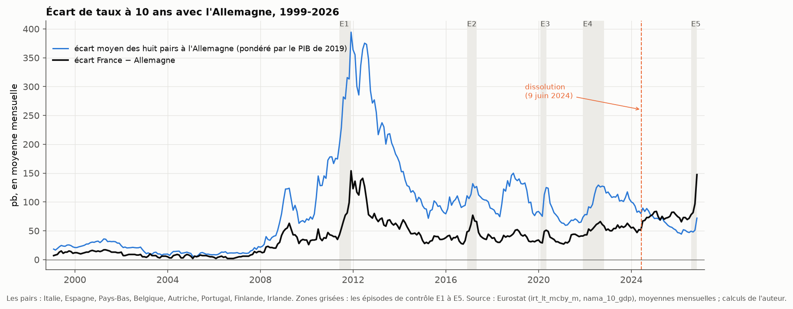
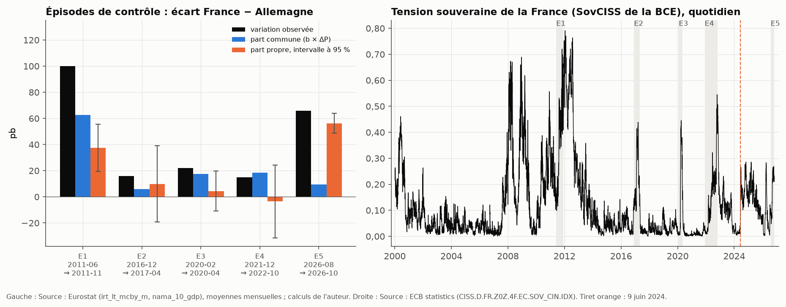
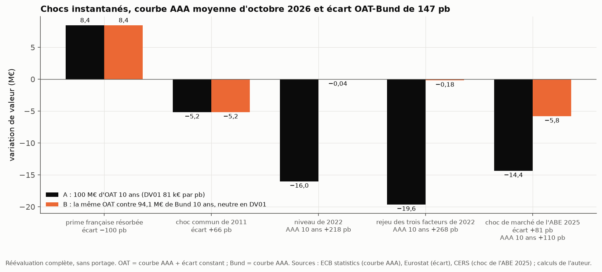
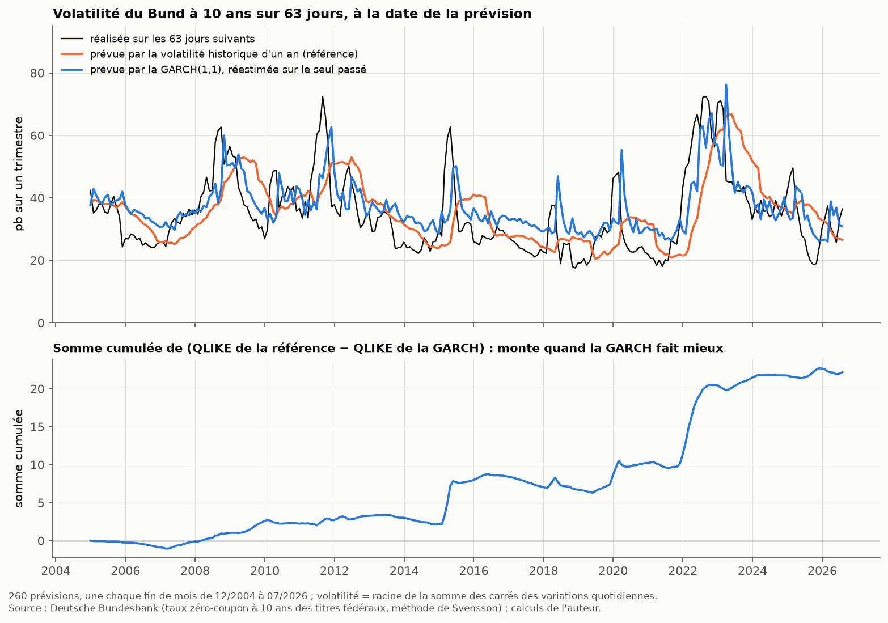
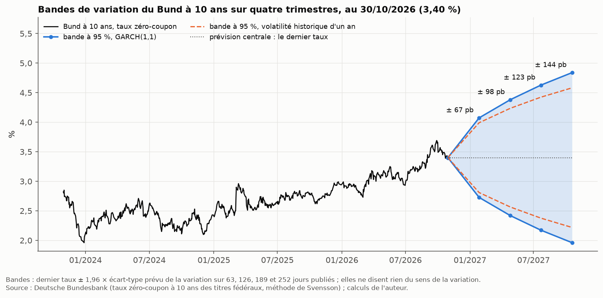

# Écart OAT-Bund : la part propre à la France

## 1. Note

**Toute la hausse de l'écart OAT-Bund de mai 2024 à octobre 2026 (+96 pb, de 51 à 147 pb en moyenne mensuelle) est
propre à la France : 100 pb [73 ; 126] ; en suivant ses pairs, l'écart aurait baissé de 3 pb.** L'intervalle est à
95 %. Les arrondis expliquent que 100 − 3 ne fasse pas 96 : la part propre vaut 99,6 pb, la part commune −3,2 pb et
la hausse 96,4 pb. L'écart moyen des huit pays pairs à l'Allemagne, pondéré par le PIB de 2019, a baissé de 8 pb sur
la période. Les cinq variantes fixées d'avance donnent toutes 99 ou 100 pb. En octobre 2026, l'écart OAT-Bund
(147 pb en moyenne mensuelle) est au plus haut depuis novembre 2011, et, en moyenne mensuelle, le taux français
dépasse l'italien pour le sixième mois depuis décembre 2025 (de moins de 4 pb avant septembre 2026), une première
depuis 1999.

- **Quand.** La part propre apparaît dès juin 2024 (12 pb), reste entre 12 et 43 pb jusqu'en août 2026, puis passe
  à 57 pb en septembre et à 100 pb en octobre 2026. L'épisode de l'automne 2026 en fait plus de la moitié : 56 pb
  [49 ; 64] en deux mois. Faute de source primaire sur ses causes, ce projet ne les date pas.
- **Ce que mesure le chiffre.** L'écart entre l'OAT-Bund observé et celui qu'aurait donné une France suivant ses
  pairs (Italie, Espagne, Pays-Bas, Belgique, Autriche, Portugal, Finlande, Irlande). Leur écart moyen à l'Allemagne
  sert de facteur commun ; la sensibilité de la France à ce facteur, estimée sur les 60 mois avant mai 2024, est
  b = 0,40 (0,40 pb d'écart français par pb d'écart moyen des pairs). La part propre est une prime de risque
  souveraine relative aux pairs : la « juste valeur » qu'elle suppose est relative, et l'écart n'est pas un pur
  risque de défaut, il contient aussi la liquidité et la rareté relative du Bund.
- **Pourquoi les variantes s'accordent.** L'écart moyen des pairs a peu bougé en net : quel que soit b, la part
  commune reste petite. Le chiffre repose donc surtout sur l'hypothèse qu'en l'absence de choc propre, la France
  aurait suivi ses pairs. Sans modèle, l'écart de la France s'est creusé contre chacun des neuf pays, de 54 pb
  (Belgique) à 122 pb (Irlande).
- **Deux réserves chiffrées.** Avant mai 2024, l'écart français montait déjà de 0,48 pb par mois de plus que le
  modèle ne l'expliquait ; prolongée, cette dérive ferait 14 pb des 100. Et si la crise française a fait monter les
  écarts des pairs (contagion), la part propre est une borne basse.
- **Contrôle sur le passé.** La méthode range la pandémie de 2020 et le resserrement monétaire de 2022 dans la part
  commune, comme le plan l'attendait, et trouve une part propre de 37 pb [19 ; 55] de juin à novembre 2011. Elle ne
  détecte pas l'élection présidentielle de 2017 (10 pb, [−19 ; 39]), que le plan attendait : sur des moyennes
  mensuelles, un épisode court et modéré lui échappe.
- **Stress.** Pour 100 M€ d'OAT à 10 ans, la DV01 et la sensibilité à l'écart valent toutes deux 81 k€ par pb. La
  résorption de la prime rapporterait 8,4 M€ ; le choc commun de 2011, transposé, coûterait 5,2 M€. Couverte contre
  le Bund en DV01, la position ne garde que le risque d'écart, mais elle le garde en entier.
- **ABE 2025.** En moyenne annuelle, l'écart observé a suivi le scénario central de l'ABE (76 pb en 2025, comme le
  scénario). Le niveau d'octobre 2026, 147 pb sur un mois, approche l'écart adverse de 2025 (157 pb) et dépasse celui
  de 2026 (135 pb) ; mais l'ABE raisonne en moyenne annuelle.
- **Prévision** (section 8, ajoutée le 23 novembre 2026). Un AR(1) ne prévoit pas le niveau du Bund à 10 ans mieux
  que le dernier taux connu ; l'amplitude de ses variations, elle, se prévoit. À un trimestre, une GARCH réduit
  l'erreur de prévision de la volatilité de 39 % face à la volatilité historique d'un an (perte QLIKE, p = 0,029),
  sans battre de façon significative une moyenne sur 63 jours. L'outil en tire des bandes de variation sur quatre
  trimestres (± 67 pb à un trimestre, au 30 octobre 2026) et un choc à 99 % : +80 pb, soit 6,5 M€ pour 100 M€
  d'OAT à 10 ans. Il ne prévoit ni le sens des variations, ni l'écart OAT-Bund.

Sources : Eurostat, BCE, CERS, Bundesbank ; calculs de l'auteur. La décomposition est une mesure, ni une prévision
ni une recommandation de position ; la section 8, ajoutée ensuite, prévoit l'amplitude des variations du Bund, pas
leur sens, et ne recommande rien non plus. Le plan a été commité avant la décomposition (écarts bruts déjà vus :
`PLAN.md`, section 0 ; commit `f938339`) ; c'est un engagement, pas une preuve. Le code de la décomposition a été
commité avant les résultats. La section 8 suit un second plan, commité seul avant toute estimation sur les données
(`PLAN_PREVISION.md`, commit `999b7cc`). Le plan (son « je » est l'agent), le code et cette note ont été rédigés et
relus par des agents d'IA (Claude Code), sous la direction de Guillaume Beaudouin ; il fixe l'objectif et les règles
de validation, et décide de ce qui est gardé.

> **In English.** The whole 96 bp rise in the 10-year OAT-Bund spread between May 2024 and October 2026 (from 51 to
> 147 bp, monthly averages) is France-specific: 100 bp [73; 126]; had France followed its peers, the spread would
> have fallen by 3 bp (100 − 3 differs from 96 by rounding). The GDP-weighted spread of eight euro-area peers to
> Germany fell by 8 bp, and all five robustness variants fixed in the plan give 99 or 100 bp. More than half of the
> French part came in September and October 2026. It is a lower bound if French stress spilled over to the peers,
> and it is not a pure default premium. For EUR 100m of 10-year OATs, one basis point of spread is worth EUR 81k.
> The plan was committed before the decomposition (raw spreads already seen: PLAN.md, section 0): a commitment, not
> a proof. Section 8, added on 23 November 2026 under a second plan committed before any estimation on the data,
> forecasts the size of 10-year Bund yield moves, not their direction: one quarter ahead, a GARCH(1,1) cuts the
> volatility forecast loss (QLIKE) by 39% against one-year historical volatility (Diebold-Mariano p = 0.029), while
> the random walk is not beaten on the level. The plan (its "I" is the agent), the code and this note were written
> and reviewed by AI agents (Claude Code) under the direction of Guillaume Beaudouin; he sets the objective and the
> validation rules, and decides what is kept.

## 2. L'écart depuis 1999



- Les taux sont les taux longs du critère de convergence publiés par Eurostat : rendements du marché secondaire
  d'obligations d'État de durée résiduelle proche de 10 ans, en moyenne mensuelle. Ils ne sont pas à maturité
  constante : les titres retenus sont remplacés à mesure qu'ils vieillissent.
- En octobre 2026, l'écart OAT-Bund est de 147 pb en moyenne mensuelle, contre 51 pb en mai 2024. Il faut remonter
  à novembre 2011 (154 pb) pour trouver un mois plus haut.
- En moyenne mensuelle, le taux français dépasse l'italien en décembre 2025, janvier et février 2026, puis d'août à
  octobre 2026 : six mois, et aucun avant décembre 2025 depuis janvier 1999. L'écart est faible jusqu'en août 2026
  (de 0,8 à 3,8 pb), puis de 7,8 pb en septembre et de 21 pb en octobre (écarts ajoutés après l'audit). En mai 2024,
  le taux français était 81 pb en dessous de l'italien.
- Les pairs pèsent selon leur PIB de 2019 : Italie 32 %, Espagne 22 %, Pays-Bas 15 %, Belgique 9 %, Autriche 7 %,
  Irlande 7 %, Finlande 4 %, Portugal 4 %. Leur écart moyen à l'Allemagne passe de 80 pb en mai 2024 à 72 pb en
  octobre 2026.
- La Grèce est exclue : son écart a atteint 2 739 pb en février 2012 et dominerait la moyenne malgré son poids, et sa
  série n'a pas de valeur en juillet 2015 (marché fermé, selon Eurostat). Le Luxembourg (pas de taux harmonisé avant
  mai 2010) et les pays entrés dans l'euro après 2001 le sont aussi.

## 3. L'observé contre le contrefactuel

**Méthode** (`PLAN.md`, sections 3 à 6 ; `src/ecart_oat_bund/decomposition.py`). En variations mensuelles et sans
constante :

    Δ écart France-Allemagne(t) = b × Δ écart moyen des pairs à l'Allemagne(t) + résidu(t)

b est estimé sur les 60 variations de juin 2019 à mai 2024 : b = 0,40 (erreur-type de Newey-West 0,05), R² non
centré 0,66, écart-type des résidus 2,7 pb. Le contrefactuel part de l'écart de mai 2024 et ajoute b fois la
variation de l'écart moyen des pairs ; la part propre à la France est l'écart observé moins le contrefactuel, soit la
somme des résidus depuis mai 2024. Son intervalle à 95 % additionne deux incertitudes : celle d'une somme de résidus
autocorrélés (les moyennes mensuelles rendent les variations successives corrélées ; estimation de Newey-West à
3 retards) et celle de b.


**Le chemin.** La part propre vaut 12 pb en juin 2024 [7 ; 18], 36 pb en décembre 2024 [22 ; 49], 41 pb en septembre
2025 [21 ; 60], 43 pb en août 2026 [17 ; 69], 57 pb en septembre 2026 [31 ; 84] et 100 pb en octobre 2026
[73 ; 126]. Les trois pointillés de la figure sont la dissolution
([décret du 9 juin 2024](https://www.legifrance.gouv.fr/jorf/id/JORFTEXT000049689651), JORF n° 0134 du 10 juin
2024), la motion de censure adoptée le 4 décembre 2024
([scrutin n° 519](https://www.assemblee-nationale.fr/dyn/17/scrutins/519), 331 voix) et la déclaration de politique
générale du gouvernement de M. François Bayrou rejetée le 8 septembre 2025
([scrutin n° 3054](https://www.assemblee-nationale.fr/dyn/17/scrutins/3054), 194 voix pour, 364 contre).

**Le modèle principal et les cinq variantes** (part propre en octobre 2026, en pb, intervalle à 95 %) :

| décomposition | fenêtre d'estimation | coefficients | part propre | intervalle |
|---|---|---|---|---|
| **modèle principal** : huit pairs | 60 mois, juin 2019 à mai 2024 | b = 0,40 | **100** | **[73 ; 126]** |
| fenêtre de 120 mois | juin 2014 à mai 2024 | b = 0,40 | 100 | [59 ; 140] |
| fenêtre depuis 1999 | 304 mois, février 1999 à mai 2024 | b = 0,38 | 99 | [52 ; 147] |
| pairs « cœur » : NL, BE, AT, FI | 60 mois | b = 0,88 | 99 | [74 ; 124] |
| pairs « périphérie » : IT, ES, PT, IE | 60 mois | b = 0,28 | 99 | [71 ; 128] |
| taux et non écarts, coefficient libre sur le Bund | 60 mois | Bund 0,59 ; pairs 0,40 | 100 | [73 ; 127] |

- **Règle de repli, fixée d'avance** : si une variante s'écartait de plus de 20 pb du modèle principal, l'en-tête
  deviendrait le tableau sans modèle ci-dessous. Le plus grand écart est de 0,7 pb : la règle ne joue pas.
- Les variantes s'accordent parce que l'écart moyen des pairs a peu bougé en net : b dépend de l'échelle du facteur
  (0,28 à 0,88), la part commune non. Dans la variante en taux, le taux français suit le Bund à 0,59
  et les pairs à 0,40 ; la somme, 0,99, est proche de 1, ce qui revient au modèle en écarts.
- **Dérive** (diagnostic fixé d'avance) : sur la fenêtre d'estimation, le résidu moyen est de 0,48 pb par mois. Un
  modèle avec constante prolongerait cette dérive, soit 14 pb sur 29 mois : la part propre serait alors de l'ordre de
  86 pb.

**Sans modèle : la France contre chaque pays**, écart de taux à 10 ans de la France au pays, en pb, en moyenne
mensuelle :

| pays | mai 2024 | octobre 2026 | variation |
|---|---|---|---|
| Allemagne | 51 | 147 | +96 |
| Italie | −81 | 21 | +102 |
| Espagne | −27 | 82 | +109 |
| Pays-Bas | 20 | 136 | +116 |
| Belgique | −3 | 51 | +54 |
| Autriche | 1 | 120 | +119 |
| Portugal | −13 | 97 | +110 |
| Finlande | 3 | 107 | +104 |
| Irlande | 12 | 134 | +122 |
| moyenne des huit pairs (PIB de 2019) | −29 | 75 | +104 |

La France s'écarte de tous. La Belgique fait exception par l'ampleur : son propre écart au Bund a monté pendant la
période, ce qui réduit celui de la France contre elle à 54 pb. Seule la ligne de l'Allemagne dépend d'un choc
propre au Bund ; les autres comparent la France à un pair, sans passer par le Bund.

## 4. Les épisodes

Le plan fixe cinq épisodes de contrôle et, pour trois d'entre eux, la lecture attendue. Pour E1 à E4, b est estimé
sur les 60 mois qui finissent au mois de base de l'épisode ; pour E5, qui tombe dans la période étudiée, le b du
modèle principal sert.

| épisode | mois | variation observée | part commune | part propre | attente du plan | vérifiée |
|---|---|---|---|---|---|---|
| E1 | juin à novembre 2011 | +100 | +63 | +37 [19 ; 55] | aucune | — |
| E2 | décembre 2016 à avril 2017 | +16 | +6 | +10 [−19 ; 39] | positive, intervalle sans 0 | **non** |
| E3 | février à avril 2020 | +22 | +18 | +4 [−11 ; 20] | intervalle contenant 0 | oui |
| E4 | décembre 2021 à octobre 2022 | +15 | +19 | −4 [−31 ; 24] | intervalle contenant 0 | oui |
| E5 | août à octobre 2026 | +66 | +10 | +56 [49 ; 64] | aucune | — |

- **E3 et E4 sont des chocs communs, et la méthode les range ainsi.** En 2020, la BCE annonce le 18 mars un
  programme d'achats d'urgence de 750 Md€ face à la pandémie
  ([communiqué](https://www.ecb.europa.eu/press/pr/date/2020/html/ecb.pr200318_1~3949d6f266.en.html)) ; en 2022,
  elle relève ses trois taux directeurs de 50 pb le 21 juillet
  ([communiqué](https://www.ecb.europa.eu/press/pr/date/2022/html/ecb.mp220721~53e5bdd317.en.html)).
- **E2 ne vérifie pas son attente.** Le premier tour de l'élection présidentielle a lieu les 22 et 23 avril 2017
  ([Conseil constitutionnel, décision n° 2017-169 PDR du 26 avril 2017](https://www.conseil-constitutionnel.fr/decision/2017/2017169PDR.htm)).
  La part propre est positive (+10 pb) mais son intervalle contient 0 : sur des moyennes mensuelles et sur quatre
  mois, la méthode n'a pas la précision de séparer un épisode de cette taille. Le résultat de 2024-2026, dix fois
  plus grand, n'est pas dans ce cas, mais la validation de la méthode sur le passé reste partielle.
- **E1** : la part commune domine (+63 pb sur +100), et la France a aussi sa part propre (+37 pb), significative.
- **E5** : 56 pb propres en deux mois, en moyenne mensuelle. L'écart moyen des pairs monte aussi de 24 pb ; si c'est
  de la contagion venue de France, la part propre est sous-estimée.
- **Le SovCISS de la France**, indicateur quotidien de tension souveraine de la BCE, sert à dater faute de taux
  français quotidien ouvert. Dans chaque épisode, il culmine le 1er novembre 2011 (0,72), le 16 mars 2017 (0,44), le
  2 avril 2020 (0,45), le 19 octobre 2022 (0,54) et le 21 octobre 2026 (0,27). En juin 2024, sa plus forte hausse sur
  un jour tombe le vendredi 14 juin, de 0,11 à 0,25. L'automne 2026 reste loin des niveaux de 2011 : l'écart y est
  au plus haut depuis 2011, la tension mesurée par l'indicateur, non.



## 5. Le stress et la DV01

Hypothèses (`PLAN.md`, section 10 ; `src/ecart_oat_bund/stress.py`) :

- **Courbes.** La courbe AAA de la BCE en moyenne d'octobre 2026 (moyenne des courbes de Svensson publiées les 22
  jours ouvrés du mois ; 3,45 % à 10 ans en zéro-coupon) tient lieu de courbe du Bund. La courbe des OAT est la courbe
  AAA plus l'écart d'octobre 2026, 147 pb en moyenne mensuelle, à toutes les maturités.
- **Positions.** (A) 100 M€ de nominal d'une OAT à 10 ans émise au pair (coupon 5,00 %, duration 8,1 ans) ; (B) la
  même OAT contre la vente de 94,1 M€ de Bund à 10 ans au pair (coupon 3,48 %, duration 8,6 ans), montant qui annule
  la DV01 de taux. Contrôle ajouté après le premier calcul : Eurostat donne 4,89 % pour la France et 3,42 % pour
  l'Allemagne en octobre 2026 ; les coupons construits sont un peu plus hauts, car la courbe AAA n'est pas celle du
  Bund seul et un coupon au pair n'est pas un taux zéro-coupon.
- **Sensibilités.** A : DV01 de taux 81 k€ par pb, sensibilité à l'écart 81 k€ par pb. B : DV01 de taux nulle,
  sensibilité à l'écart 81 k€ par pb.
- **Chocs instantanés**, réévaluation complète, sans portage :
  - C1, prime française résorbée : l'écart baisse de la part propre, 100 pb ;
  - C2, choc commun de 2011 : l'écart monte de b × la hausse de l'écart moyen des pairs de juin à novembre 2011, soit
    0,40 × 165 = 66 pb ;
  - C3, niveau de 2022 : la courbe AAA monte de 218 pb, la variation du niveau de Nelson-Siegel de fin 2021 à fin
    2022 ;
  - C4, rejeu des trois facteurs de 2022 (niveau +218 pb, pente +4 pb, courbure +361 pb) : +268 pb à 10 ans ;
  - C5, choc de marché de l'ABE 2025 : écart OAT-Bund +81 pb et Bund +110 pb à 10 ans (section 6).

| choc | écart à 10 ans | courbe AAA (Bund) à 10 ans | A : OAT seule | B : OAT contre Bund |
|---|---|---|---|---|
| C1 prime française résorbée | −100 pb | | **+8,4 M€** | **+8,4 M€** |
| C2 choc commun de 2011 | +66 pb | | −5,2 M€ | −5,2 M€ |
| C3 niveau de 2022 | | +218 pb | −16,0 M€ | −0,04 M€ |
| C4 rejeu des trois facteurs de 2022 | | +268 pb | −19,6 M€ | −0,18 M€ |
| C5 choc de marché de l'ABE 2025 | +81 pb | +110 pb | −14,4 M€ | −5,8 M€ |

- **La prime mesurée vaut 8,4 M€ pour 100 M€ d'OAT à 10 ans** : c'est ce que rendrait son retour à zéro, contre
  8,1 M€ au premier ordre (81 k€ × 100 pb) ; la convexité ajoute le reste.
- **La couverture en DV01 enlève le risque de taux, pas le risque d'écart.** Sous les chocs de 2022, B ne bouge
  presque pas (−0,04 et −0,18 M€) ; sous C1, C2 et le choc d'écart de l'ABE, il perd ou gagne comme A.
- **Le choc commun de 2011 ne rejoue pas 2011.** Il ne transpose que l'élargissement commun, à la sensibilité
  d'aujourd'hui ; en 2011, la France a aussi eu sa part propre (+37 pb, section 4).



## 6. L'ABE 2025

L'ABE a lancé le 20 janvier 2025 son test de résistance sur 2025-2027, avec un scénario adverse conçu par le CERS
([communiqué](https://www.eba.europa.eu/publications-and-media/press-releases/eba-launches-its-2025-eu-wide-stress-test)) ;
le scénario de marché a été mis à jour le 12 février 2025. Écart France-Allemagne des taux longs, en pb, calculé
par l'auteur à partir des taux du scénario macrofinancier du CERS :

| | 2024 | décembre 2024 | 2025 | 2026 | 2027 |
|---|---|---|---|---|---|
| ABE, point de départ | 64 | 80 | | | |
| ABE, scénario central | | | 76 | 84 | 88 |
| ABE, scénario adverse | | | 157 | 135 | 117 |
| observé (Eurostat), moyenne annuelle | 65 | | 76 | 83 (janvier à octobre) | |

- Les taux longs de l'ABE sont très proches de ceux d'Eurostat : la moyenne 2024 qu'elle retient est de 2,98 % pour
  la France et 2,34 % pour l'Allemagne, contre 2,97 % et 2,32 % chez Eurostat.
- **En moyenne annuelle, l'écart a suivi le scénario central**, pas l'adverse : 76 pb en 2025 pour 76 dans le
  scénario central et 157 dans l'adverse. Le niveau d'octobre 2026 (147 pb en moyenne mensuelle) approche
  l'adverse de 2025 (157 pb) et dépasse celui de 2026 (135 pb), mais c'est un mois contre des moyennes annuelles.
- **Le choc de marché de l'ABE** (instantané, à 10 ans) monte le swap en euro de 79 pb, l'écart souverain français
  contre swap de 112 pb et l'allemand de 31 pb : +191 pb pour le taux français, +110 pb pour l'allemand, +81 pb pour
  l'écart OAT-Bund. Ces écarts sont mesurés contre swap, pas contre le Bund ; seule leur différence se compare à
  l'OAT-Bund.

## 7. Les limites

- **Le niveau d'octobre 2026 n'est pas confronté à une source de marché quotidienne.** L'audit indépendant n'a pas pu
  le vérifier sur des prix quotidiens ouverts, et le SovCISS de la France n'en confirme pas l'ampleur (0,27 au plus
  pendant l'automne 2026, contre 0,72 en 2011).
- **Moyennes mensuelles.** Pas de taux français quotidien ouvert : la Banque de France publie les TEC, mais ce sont
  des indices d'Euronext qu'on ne peut redistribuer ; l'API Webstat exige un compte ; le site de l'AFT refuse les
  scripts. Un épisode de quelques jours se dilue dans la moyenne du mois (section 4, E2).
- **Pas de maturité constante.** Les titres de référence changent ; un changement de titre déplace un peu l'écart
  sans mouvement de marché.
- **Le contrefactuel est une hypothèse.** La France aurait suivi ses pairs avec la sensibilité de 2019-2024, sans
  dérive propre. Avec la dérive d'avant 2024, la part propre perd 14 pb. Les variantes ne testent pas cette
  hypothèse ; elles testent b, qui pèse peu ici.
- **Contagion.** Si la crise française a fait monter les écarts des pairs (par exemple de 24 pb à l'automne 2026),
  la part commune est surestimée et la part propre est une borne basse.
- **Un choc propre au Bund déplace tous les écarts.** L'offre de Bund ou sa rareté comme collatéral changent
  l'écart de tous les pays à l'Allemagne ; la variante en taux, avec un coefficient libre sur le Bund, ne change
  pas le résultat.
- **Ce que contient l'écart.** Risque de crédit et de notation, liquidité, offre de titres, demande de Bund comme
  actif sûr : la décomposition ne les sépare pas. Ni CDS, ni décisions des agences de notation dans les données.
- **Pondération.** Les pairs sont pondérés par le PIB de 2019, pas par l'encours de dette négociable ; ce PIB
  surpondère l'Irlande, gonflé par les multinationales.
- **Stress.** La courbe AAA de la BCE, estimée sur les titres d'État notés AAA, tient lieu de courbe du Bund ; écart
  constant à toutes les maturités ; écart de rendements ajouté à des taux zéro-coupon en composition continue ;
  chocs instantanés, sans portage ni probabilité. Ce sont des scénarios, pas des prévisions.
- **Pas de marché primaire, pas de coût budgétaire** : le programme de financement de l'AFT n'a pas pu être lu par
  script, et aucun chiffre n'en est repris.

## 8. Prévoir : le niveau ou l'amplitude ?

**À un trimestre, la volatilité du Bund à 10 ans se prévoit : la GARCH réduit l'erreur de 39 % face à la volatilité
historique d'un an.** L'erreur est la perte QLIKE moyenne, celle du test fixé d'avance : 0,133 pour la GARCH(1,1),
0,218 pour la référence (test de Diebold-Mariano, p = 0,029, 260 prévisions). En pb, l'erreur quadratique moyenne
sur la volatilité du trimestre passe de 11,6 à 9,6 pb, soit encore plus du quart d'une volatilité réalisée de
35 pb en moyenne. Le niveau du taux, lui, n'est pas mieux prévu par un AR(1) que par le dernier taux connu.

Section ajoutée le 23 novembre 2026, après les sections 1 à 7, qu'elle ne modifie pas. Elle suit un second plan,
commité seul avant toute estimation sur les données (`PLAN_PREVISION.md`, commit `999b7cc` ; ce qui avait été vu
est dans sa section 0) ; c'est un engagement, pas une preuve. Ce plan, le code et le texte de la section ont été
rédigés et relus comme le reste de la page (section 1).

- **La question.** Pour un exercice trimestriel de prévision et de stress, que prévoit-on mieux qu'une règle simple
  sur le Bund : le niveau, ou l'amplitude de ses variations ?
- **Ce qui n'est pas prévu.** Le sens des variations : une amplitude ne dit pas si le taux monte ou baisse. Et
  l'amplitude de l'écart OAT-Bund : aucun taux OAT quotidien n'est ouvert (section 7).

**Protocole** (`PLAN_PREVISION.md` ; `src/ecart_oat_bund/prevision.py`).

- **Série.** Le taux zéro-coupon à 10 ans des titres fédéraux, publié chaque jour par la Bundesbank, du 7 août 1997
  au 30 octobre 2026 (7 421 jours). Les variations quotidiennes sont en pb. Le taux est publié à deux décimales :
  chaque variation est un nombre entier de pb.
- **Origines et cible.** Une prévision chaque fin de mois depuis décembre 2004, avec les seules données connues ce
  jour-là. La cible est la somme des carrés des variations des 63 jours publiés suivants (un trimestre) ou des 21
  suivants (un mois) ; sa racine est la volatilité de l'horizon, en pb.
- **Quatre règles.** Une GARCH(1,1) à moyenne nulle (Bollerslev, 1986), réestimée à chaque origine sur tout le
  passé (paquet `arch` ; 263 ajustements, tous convergés) ; la volatilité historique sur 252 jours, qui sert de
  référence ; la volatilité historique sur 63 jours ; une moyenne exponentielle de paramètre 0,94 (EWMA ;
  RiskMetrics, 1996).
- **Perte.** QLIKE = RV/F − ln(RV/F) − 1, où RV est la variance réalisée et F la prévision ; elle vaut zéro quand
  F = RV. Elle classe les règles correctement même si RV mesure la variance avec bruit (Patton, 2011), et une
  prévision trop basse y coûte plus qu'une prévision trop haute.
- **Test.** Diebold et Mariano (1995), erreurs-types de Newey-West à 6 retards à un trimestre et 2 retards à un
  mois : les origines sont mensuelles et les cibles se chevauchent.
- **Décision fixée d'avance.** Un seul test décide du titre : 10 ans, 63 jours, GARCH contre référence, seuil de
  5 %. En cas d'échec, le titre aurait porté sur 21 jours ; en cas de double échec, la section n'aurait pas été
  publiée. Le test passe : le repli ne joue pas.

**Résultats sur le Bund à 10 ans** (QLIKE moyenne ; RMSE et biais de la volatilité prévue, en pb ; un biais positif
dit que la règle prévoit trop) :

| règle | QLIKE, 63 jours | RMSE | biais | QLIKE, 21 jours | RMSE | biais |
|---|---|---|---|---|---|---|
| GARCH(1,1) | **0,133** | 9,6 | +2,3 | 0,172 | 6,3 | +1,1 |
| volatilité historique, 252 jours (référence) | **0,218** | 11,6 | +0,8 | 0,254 | 7,4 | +0,7 |
| volatilité historique, 63 jours | 0,155 | 10,0 | −0,1 | 0,201 | 6,7 | +0,2 |
| EWMA 0,94 | 0,167 | 10,1 | −0,8 | 0,200 | 6,4 | −0,2 |

| gain de la GARCH (QLIKE) face à | 63 jours | p | 21 jours | p |
|---|---|---|---|---|
| la volatilité historique, 252 jours | **39 %** | **0,029** | 32 % | 0,004 |
| la volatilité historique, 63 jours | 14 % | 0,291 | 15 % | 0,050 |
| l'EWMA 0,94 | 21 % | 0,097 | 14 % | 0,025 |



- **Ce que le test montre.** Une moyenne sur un an réagit trop lentement quand la volatilité change. La GARCH fait
  mieux qu'elle à un trimestre (39 %) comme à un mois (32 %, p = 0,004).
- **Ce qu'il ne montre pas.** Que la GARCH batte les deux autres règles simples. À un trimestre, son gain est de
  14 % face à la volatilité sur 63 jours (p = 0,291) et de 21 % face à l'EWMA (p = 0,097) : ni l'un ni l'autre
  n'est significatif. Une moyenne des 63 derniers jours capte déjà l'essentiel du gain.
- **Le gain vient de peu d'épisodes.** 260 prévisions mensuelles ne font que 86 trimestres sans chevauchement.
  Trois années, 2015, 2020 et 2022, font 87 % de l'écart de perte cumulé (figure, panneau du bas), dont 49 % pour
  2022 seule. Sans les cibles qui finissent en 2022 ou 2023, le gain tombe à 26 % ; sans celles de 2008 et 2009,
  il reste de 38 %. La GARCH fait mieux que la référence 15 années sur 22.
- **La GARCH prévoit un peu trop.** Son biais est de +2,3 pb à un trimestre, et de +5,0 pb sur 2015-2021 (voir la
  robustesse).

**Le niveau** : marche aléatoire contre AR(1), Bund à 10 ans en fin de mois, mêmes origines.

| horizon | prévisions | RMSE, marche aléatoire | RMSE, AR(1) | rapport | p |
|---|---|---|---|---|---|
| 3 mois | 260 | 34 pb | 35 pb | 1,04 | 0,049 |
| 12 mois | 251 | 75 pb | 87 pb | 1,15 | 0,015 |

- La marche aléatoire n'est pas battue, et l'AR(1) fait moins bien aux deux horizons. Le plan l'attendait
  (sa section 0) : dans un autre travail, non publié, un modèle de Nelson-Siegel dynamique n'avait pas battu non plus
  la marche aléatoire sur la courbe AAA ; sa RMSE était plus élevée de 19 %, 21 % et 30 % à 1, 6 et 12 mois.
- L'erreur de la marche aléatoire à 3 mois, 34 pb, est du même ordre que la volatilité d'un trimestre (35 pb en
  moyenne). On ne sait pas dire où ira le taux ; on sait dire de combien il peut bouger, et c'est cette amplitude
  qui se prévoit.

**Robustesse** : gain de la GARCH face à la volatilité historique sur 252 jours, variantes fixées d'avance.

| variante | prévisions à 63 jours | gain à 63 jours | p | gain à 21 jours | p |
|---|---|---|---|---|---|
| **calcul principal** : Bund à 10 ans | 260 | **39 %** | **0,029** | 32 % | 0,004 |
| Bund à 2 ans | 260 | 38 % | 0,233 | 27 % | 0,182 |
| 10 ans de la courbe AAA de la BCE (origines depuis juillet 2008) | 217 | 31 % | 0,050 | 29 % | 0,004 |
| Bund à 10 ans, mêmes origines que la courbe AAA | 217 | 41 % | 0,030 | 33 % | 0,005 |
| GARCH en fenêtre glissante de 10 ans | 260 | 29 % | 0,045 | 29 % | 0,006 |
| cibles qui finissent en 2005-2014 | 117 | 17 % | 0,225 | 14 % | 0,116 |
| cibles qui finissent en 2015-2021 | 85 | 33 % | 0,207 | 32 % | 0,093 |
| cibles qui finissent en 2022-2026 | 58 | 62 % | 0,099 | 51 % | 0,037 |

- **Le signe tient partout, la significativité une fois sur deux.** Les 16 comparaisons du tableau donnent un gain
  positif ; 8 passent le seuil de 5 %, aucune ne donne une perte significative. Le plan compte 48 tests sur la
  volatilité, dont un seul décide ; tous sont dans `resultats/prevision.json`.
- **Bund à 2 ans.** Gain du même ordre, non significatif. Les pertes y sont plus de deux fois plus élevées (0,316
  pour la GARCH, 0,506 pour la référence, à un trimestre) ; une cible plus bruitée l'expliquerait, ce qui n'est pas
  testé ici.
- **Courbe AAA.** À un trimestre, p = 0,0501 : juste au-dessus du seuil, donc non significatif selon la règle. Aux
  mêmes origines, le Bund donne 41 % (p = 0,030) : une courbe estimée à part, par la BCE, donne un gain voisin, un
  peu plus faible.
- **Fenêtre glissante.** Le biais de la GARCH est réduit de moitié (+1,2 pb à un trimestre), mais sa perte monte à
  0,155, au niveau de la volatilité sur 63 jours.
- **Sous-périodes.** Le gain est positif dans les trois ; à un trimestre, il n'est significatif dans aucune.
- **2015-2021, la volatilité écrasée.** La volatilité réalisée tombe à 27 pb par trimestre en moyenne, et la GARCH
  prévoit 5,0 pb de trop, contre 0,8 pour la référence. Estimée sur une fenêtre croissante, elle garde une
  volatilité de long terme de 5,1 pb par jour à la fin de 2014 et de 4,8 à la fin de 2021, quand la volatilité d'un
  an est de 3,0 puis de 2,7 pb par jour. Sa perte reste plus faible que celle de la référence (0,177 contre 0,263),
  sans que l'écart soit significatif.

**Les bandes à 95 % dans le back test** : part des origines où la variation réalisée du taux est restée dans la
bande (dernier taux ± 1,96 fois l'écart-type prévu).

| horizon | fenêtres sans chevauchement | GARCH | volatilité historique, 252 jours |
|---|---|---|---|
| 21 jours | 262 | 97,3 % | 94,7 % |
| 63 jours | 86 | 96,2 % | 95,0 % |
| 126 jours | 42 | 94,6 % | 91,8 % |
| 189 jours | 28 | 95,3 % | 91,7 % |
| 252 jours | 20 | 94,4 % | 90,8 % |

- Les bandes de la GARCH sont un peu trop larges jusqu'à un trimestre, proches de 95 % au-delà. Celles de la
  référence sont justes à un trimestre, trop étroites au-delà.
- **Queues.** Un quantile de loi normale sous-estime en général les queues. Ici, à un trimestre, la variation a
  dépassé 2,326 écarts-types prévus par la GARCH 4 fois sur 260 (3 hausses, 1 baisse), pour 5 attendues sous une loi
  normale, et 9 fois avec la référence. Mais le plus grand écart, 3,3 écarts-types, vient de la prévision de fin
  janvier 2022 : il serait très rare sous une loi normale, et 86 trimestres ne suffisent pas à estimer un quantile à
  99 %.

**La sortie de l'outil.** `uv run python scripts/prevision.py` affiche les bandes de variation du Bund à 10 ans
sur quatre trimestres. Au 30 octobre 2026, dernier jour retenu, le taux zéro-coupon est de 3,40 % :

| horizon | bande à 95 %, GARCH | soit | bande à 95 %, volatilité historique sur 252 jours |
|---|---|---|---|
| 1 trimestre (63 jours) | ± 67 pb | de 2,73 % à 4,07 % | ± 59 pb |
| 2 trimestres (126 jours) | ± 98 pb | de 2,42 % à 4,38 % | ± 84 pb |
| 3 trimestres (189 jours) | ± 123 pb | de 2,17 % à 4,63 % | ± 102 pb |
| 4 trimestres (252 jours) | ± 144 pb | de 1,96 % à 4,84 % | ± 118 pb |



- **Pourquoi la GARCH donne des bandes plus larges.** Fin octobre 2026, elle prévoit un écart-type de 4,1 pb pour
  le lendemain, puis revient vers son niveau de long terme, 5,0 pb par jour (α + β = 0,992, soit une demi-vie de
  90 jours). La volatilité d'un an est de 3,8 pb par jour. C'est le mécanisme du biais de 2015-2021 : si la
  volatilité reste basse, ces bandes sont trop larges.
- **Choc à 99 % sur un trimestre : +80 pb**, soit 2,326 fois l'écart-type prévu (34 pb). Appliqué à la DV01 de la
  section 5 (81 k€ par pb pour 100 M€ d'OAT à 10 ans), il coûte 6,5 M€ au premier ordre, écart OAT-Bund inchangé.
  La position B, neutre en DV01, n'y est pas exposée : son risque est l'écart, que l'outil ne prévoit pas. À titre
  d'échelle, le choc de marché de l'ABE 2025 monte le Bund de 110 pb (section 5).
- Le plan retenait le plus grand de deux quantiles : celui de la loi normale (2,326) et le quantile empirique des
  variations standardisées du back test (2,24). Le quantile normal l'emporte.

**Limites propres à cette section.**

- **Une amplitude, pas un sens.** Les bandes sont symétriques autour du dernier taux ; elles ne disent pas s'il
  montera.
- **Un taux lissé.** Le zéro-coupon de la Bundesbank est estimé par la méthode de Svensson et publié à deux
  décimales : ce n'est pas le rendement d'un titre négocié, et ses variations quotidiennes sont arrondies au pb.
- **Une cible bruitée.** 63 carrés de variations quotidiennes mesurent la variance avec bruit. Le classement par
  QLIKE y résiste en espérance ; le niveau des pertes, non.
- **Peu d'épisodes indépendants.** 86 trimestres sans chevauchement, et trois années qui font 87 % du gain : la
  valeur p de 0,029 repose sur eux.
- **Une seule référence battue.** Le titre porte sur la volatilité d'un an. Face à une moyenne sur 63 jours ou à
  l'EWMA, le gain de la GARCH n'est pas significatif à un trimestre.
- **Un biais vers le haut** quand la volatilité reste basse longtemps, comme en 2015-2021.
- **Des queues mal connues.** Le choc à 99 % repose sur un quantile normal, que 86 trimestres ne peuvent ni valider
  ni réfuter.
- **Au-delà d'un trimestre**, les bandes prolongent le même modèle ; leur couverture n'est mesurée que sur 20 à
  42 fenêtres sans chevauchement.
- **Pas l'écart OAT-Bund**, faute de taux OAT quotidien ouvert ; l'outil ne couvre que le risque de taux.
- **Une seule forme de GARCH**, symétrique et à loi normale. **Aucune comparaison** avec les prévisions d'une banque
  ou d'une institution.
- **Écarts au plan.** Quelques descriptifs cités ici ne sont pas listés par le plan, mais le script les calculait
  déjà quand il a été commité, avant le calcul : le plus grand écart standardisé, la volatilité d'un an à la fin de
  2014 et de 2021, la demi-vie de la GARCH. Aucun n'est un test. Après le calcul, le script n'a changé que pour la
  mise en page des deux figures et pour une note qui liste ces descriptifs dans `resultats/prevision.json` ; aucun
  chiffre n'a changé.

## 9. Reproduire

```
uv sync --group dev
uv run python scripts/tout.py                 # télécharge, calcule, prévoit, trace et vérifie le README ; une à deux minutes
uv run python scripts/prevision.py            # la prévision seule : bandes sur quatre trimestres et choc à 99 %
uv run pytest                                 # tests sur des cas calculables à la main ou simulés
```

`scripts/tout.py` enchaîne `telecharger.py`, `decomposition.py`, `stress.py`, `abe.py`, `controles.py`,
`prevision.py` et `verifier_readme.py`. Ce dernier recalcule chaque chiffre de cette page depuis les JSON de
`resultats/` et signale tout nombre qui n'en sort pas. **Mise à jour en une commande :** `uv run python
scripts/tout.py --dernier-mois 2026-11` prolonge la fenêtre d'un mois ; la vérification dira alors quels chiffres de
la page ont changé. Les chiffres de cette page viennent des données téléchargées le 22 novembre 2026, et le
23 novembre pour les séries de la Bundesbank depuis 1997 ; Eurostat peut réviser le PIB, ce qui déplacerait un peu
les poids.

| fichier | |
|---|---|
| `PLAN.md` | le plan, commité avant la décomposition (écarts bruts déjà vus : section 0) ; un engagement, pas une preuve |
| `PLAN_PREVISION.md` | le plan de la section 8, commité seul avant toute estimation sur les données (ce qui avait été vu : section 0) ; un engagement, pas une preuve |
| `src/ecart_oat_bund/donnees.py` | téléchargement et lecture des sources |
| `src/ecart_oat_bund/decomposition.py` | estimation, part propre, intervalle de Newey-West, tableau sans modèle |
| `src/ecart_oat_bund/analyse.py` | le plan traduit en constantes : fenêtres, groupes, variantes, épisodes |
| `src/ecart_oat_bund/stress.py` | prix, duration, DV01, courbe des OAT, position neutre en DV01, chocs |
| `src/ecart_oat_bund/nelson_siegel.py` | courbe de Svensson de la BCE et facteurs de Nelson-Siegel (rejeu de 2022) |
| `src/ecart_oat_bund/prevision.py` | variations quotidiennes, origines, GARCH(1,1) et règles simples, QLIKE, Diebold-Mariano, bandes, niveau |
| `resultats/*.json` | tous les chiffres ; `references.json`, écrit à la main, donne les constantes du plan et les sources des événements ; `prevision_par_origine.csv` détaille la section 8, origine par origine |

## 10. Les données et leurs conditions de réutilisation

| source | séries | conditions |
|---|---|---|
| Eurostat | `irt_lt_mcby_m` (taux longs du critère de convergence, collectés par la BCE auprès des banques centrales nationales), `nama_10_gdp` (PIB de 2019) | réutilisation libre, commerciale ou non, « à condition de mentionner la source » ([avis de droit d'auteur](https://ec.europa.eu/eurostat/fr/help/copyright-notice)) |
| BCE | courbe AAA `YC/B.U2.EUR.4F.G_N_A.SV_C_YM`, SovCISS de la France `CISS/D.FR.Z0Z.4F.EC.SOV_CIN.IDX` | réutilisation gratuite « on the condition that the source is quoted (e.g. "Source: ECB statistics.") and that the statistics (including metadata) are not modified » ([politique du SEBC](https://www.ecb.europa.eu/stats/ecb_statistics/governance_and_quality_framework/html/usage_policy.en.html)) |
| CERS (ESRB) | scénarios macrofinancier et de marché de l'ABE 2025 | libre usage, à condition de citer le CERS et de signaler toute transformation ([avis juridique](https://www.esrb.europa.eu/services/disclaimer/html/index.en.html)) |
| Bundesbank | 10 ans et 2 ans zéro-coupon des titres fédéraux, `BBSIS/D.I.ZST.ZI.EUR.S1311.B.A604.R10XX.R.A.A._Z._Z.A` et `…R02XX…`, quotidiens depuis août 1997 (section 8 ; le 10 ans sert aussi de contrôle) | politique du SEBC, comme la BCE |
| Banco de España | 10 ans espagnol du marché secondaire, série `D_G0B1F0ZP` (contrôle) | réutilisation libre en citant « Banco de España » et en signalant le traitement ([conditions](https://www.bde.es/wbe/es/estadisticas/recursos/terminos/terminos-de-uso.html)) |

- Les données brutes ne sont pas versionnées : `scripts/telecharger.py` les recrée dans `data/`. Les TEC de la
  Banque de France ne sont ni téléchargés ni utilisés : ce sont des indices d'Euronext, qui « ne peuvent être
  redistribuées, sous-licenciées ou utilisées à des fins commerciales […] sans l'autorisation écrite préalable
  d'Euronext Paris ».
- **Licence.** Le code est sous licence MIT (fichier `LICENSE`) ; elle ne couvre pas les données, qui restent
  soumises aux conditions de leurs producteurs, ci-dessus.
- **Contrôles.** La moyenne mensuelle du 10 ans zéro-coupon de la Bundesbank suit la série allemande d'Eurostat
  (corrélation des variations mensuelles 0,991) ; elle est plus haute de 12,5 pb en moyenne, car un taux zéro-coupon
  n'est pas le rendement d'un titre à coupon. Celle du 10 ans du Banco de España redonne la série espagnole à
  0,05 pb près en moyenne (corrélation 0,999).
- Sources des événements : Légifrance, Assemblée nationale, Conseil constitutionnel, BCE, ABE (liens dans le texte
  et dans `resultats/references.json`).
