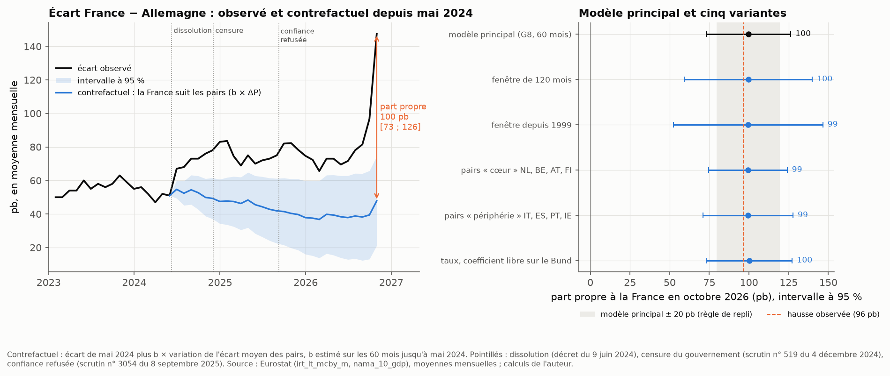

# Écart OAT-Bund : la part propre à la France

## 1. Note

**Sur 96 pb de hausse de l'écart de taux à 10 ans entre la France et l'Allemagne, de mai 2024 à octobre 2026 et en
moyenne mensuelle, 100 pb [73 ; 126] sont propres à la France** (intervalle à 95 %). Les huit pays pairs ne
l'expliquent pas : leur écart moyen à l'Allemagne, pondéré par le PIB de 2019, a baissé de 8 pb sur la période, et
la part commune de l'écart français est de −3 pb ; la part propre dépasse donc la hausse observée. Les cinq
variantes fixées d'avance donnent toutes 99 ou 100 pb. En octobre 2026, l'écart OAT-Bund (147 pb en moyenne
mensuelle) est au plus haut depuis novembre 2011, et le taux français dépasse l'italien pour le sixième mois
depuis décembre 2025, une première depuis 1999.

- **Quand.** La part propre apparaît dès juin 2024 (12 pb), reste entre 12 et 43 pb jusqu'en août 2026, puis passe
  à 57 pb en septembre et à 100 pb en octobre 2026. L'épisode de l'automne 2026 en fait plus de la moitié : 56 pb
  [49 ; 64] en deux mois. Faute de source primaire sur ses causes, ce projet ne les date pas.
- **Ce que mesure le chiffre.** L'écart entre l'OAT-Bund observé et celui qu'aurait donné une France suivant ses
  pairs (Italie, Espagne, Pays-Bas, Belgique, Autriche, Portugal, Finlande, Irlande). Leur écart moyen à l'Allemagne
  sert de facteur commun ; la sensibilité de la France à ce facteur, estimée sur les 60 mois avant mai 2024, est
  b = 0,40 (0,40 pb d'écart français par pb d'écart moyen des pairs). La part propre est une prime de risque
  souveraine relative aux pairs : la « juste valeur » qu'elle suppose est relative, et l'écart n'est pas un pur
  risque de défaut, il contient aussi la liquidité et la rareté relative du Bund.
- **Pourquoi les variantes s'accordent.** L'écart moyen des pairs a peu bougé en net : quel que soit b, la part
  commune reste petite. Le chiffre repose donc surtout sur l'hypothèse qu'en l'absence de choc propre, la France
  aurait suivi ses pairs. Sans modèle, l'écart de la France s'est creusé contre chacun des neuf pays, de 54 pb
  (Belgique) à 122 pb (Irlande).
- **Deux réserves chiffrées.** Avant mai 2024, l'écart français montait déjà de 0,48 pb par mois de plus que le
  modèle ne l'expliquait ; prolongée, cette dérive ferait 14 pb des 100. Et si la crise française a fait monter les
  écarts des pairs (contagion), la part propre est une borne basse.
- **Contrôle sur le passé.** La méthode range la pandémie de 2020 et le resserrement monétaire de 2022 dans la part
  commune, comme le plan l'attendait, et trouve une part propre de 37 pb [19 ; 55] de juin à novembre 2011. Elle ne
  détecte pas l'élection présidentielle de 2017 (10 pb, [−19 ; 39]), que le plan attendait : sur des moyennes
  mensuelles, un épisode court et modéré lui échappe.
- **Stress.** Pour 100 M€ d'OAT à 10 ans, la DV01 et la sensibilité à l'écart valent toutes deux 81 k€ par pb. La
  résorption de la prime rapporterait 8,4 M€ ; le choc commun de 2011, transposé, coûterait 5,2 M€. Couverte contre
  le Bund en DV01, la position ne garde que le risque d'écart, mais elle le garde en entier.
- **ABE 2025.** En moyenne annuelle, l'écart observé a suivi le scénario central de l'ABE (76 pb en 2025, comme le
  scénario) ; le niveau d'octobre 2026, 147 pb sur un mois, approche celui du scénario adverse pour 2025, 157 pb en
  moyenne annuelle.

Sources : Eurostat, BCE, CERS ; calculs de l'auteur. C'est une mesure, ni une prévision ni une recommandation de
position. Le plan a été commité avant tout calcul
(`PLAN.md`, commit `f938339`), le code de la décomposition avant les résultats. Le code a été écrit et relu par des
agents de programmation IA (Claude Code) sous la direction de l'auteur ; il fixe l'objectif et les règles de
validation, et décide de ce qui est gardé.

> **In English.** Of the 96 bp rise in the 10-year France-Germany yield spread between May 2024 and October 2026
> (monthly averages), 100 bp [73; 126] are specific to France: the GDP-weighted spread of eight euro-area peers to
> Germany fell by 8 bp over the period, and all five robustness variants fixed in the plan give 99 or 100 bp. More
> than half of it came in September and October 2026. The French part is a lower bound if French stress spilled over to the
> peers; it is not a pure default premium. For EUR 100m of 10-year OATs, one basis point of spread is worth
> EUR 81k. Plan committed before any computation. Code written and reviewed by AI coding agents (Claude Code) under
> the author's direction; he sets the objective and the validation rules, and decides what is kept.

## 2. L'écart depuis 1999


- Les taux sont les taux longs du critère de convergence publiés par Eurostat : rendements du marché secondaire
  d'obligations d'État de durée résiduelle proche de 10 ans, en moyenne mensuelle. Ils ne sont pas à maturité
  constante : les titres retenus sont remplacés à mesure qu'ils vieillissent.
- En octobre 2026, l'écart OAT-Bund est de 147 pb en moyenne mensuelle, contre 51 pb en mai 2024. Il faut remonter
  à novembre 2011 (154 pb) pour trouver un mois plus haut.
- En moyenne mensuelle, le taux français dépasse l'italien en décembre 2025, janvier et février 2026, puis d'août
  à octobre 2026 :
  six mois, et aucun avant décembre 2025 depuis janvier 1999. En mai 2024, il était 81 pb en dessous ; en octobre
  2026, il est 21 pb au-dessus.
- Les pairs pèsent selon leur PIB de 2019 : Italie 32 %, Espagne 22 %, Pays-Bas 15 %, Belgique 9 %, Autriche 7 %,
  Irlande 7 %, Finlande 4 %, Portugal 4 %. Leur écart moyen à l'Allemagne passe de 80 pb en mai 2024 à 72 pb en
  octobre 2026.
- La Grèce est exclue : son écart a atteint 2 739 pb en février 2012 et dominerait la moyenne malgré son poids, et sa
  série n'a pas de valeur en juillet 2015 (marché fermé, selon Eurostat). Le Luxembourg (pas de taux harmonisé avant
  mai 2010) et les pays entrés dans l'euro après 2001 le sont aussi.

## 3. L'observé contre le contrefactuel

**Méthode** (`PLAN.md`, sections 3 à 6 ; `src/ecart_oat_bund/decomposition.py`). En variations mensuelles et sans
constante :

    Δ écart France-Allemagne(t) = b × Δ écart moyen des pairs à l'Allemagne(t) + résidu(t)

b est estimé sur les 60 variations de juin 2019 à mai 2024 : b = 0,40 (erreur-type de Newey-West 0,05), R² non
centré 0,66, écart-type des résidus 2,7 pb. Le contrefactuel part de l'écart de mai 2024 et ajoute b fois la
variation de l'écart moyen des pairs ; la part propre à la France est l'écart observé moins le contrefactuel, soit la
somme des résidus depuis mai 2024. Son intervalle à 95 % additionne deux incertitudes : celle d'une somme de résidus
autocorrélés (les moyennes mensuelles rendent les variations successives corrélées ; estimation de Newey-West à
3 retards) et celle de b.



**Le chemin.** La part propre vaut 12 pb en juin 2024 [7 ; 18], 36 pb en décembre 2024 [22 ; 49], 41 pb en septembre
2025 [21 ; 60], 43 pb en août 2026 [17 ; 69], 57 pb en septembre 2026 [31 ; 84] et 100 pb en octobre 2026
[73 ; 126]. Les trois pointillés de la figure sont la dissolution
([décret du 9 juin 2024](https://www.legifrance.gouv.fr/jorf/id/JORFTEXT000049689651), JORF n° 0134 du 10 juin
2024), la motion de censure adoptée le 4 décembre 2024
([scrutin n° 519](https://www.assemblee-nationale.fr/dyn/17/scrutins/519), 331 voix) et la déclaration de politique
générale du gouvernement de M. François Bayrou rejetée le 8 septembre 2025
([scrutin n° 3054](https://www.assemblee-nationale.fr/dyn/17/scrutins/3054), 194 voix pour, 364 contre).

**Le modèle principal et les cinq variantes** (part propre en octobre 2026, en pb, intervalle à 95 %) :

| décomposition | fenêtre d'estimation | coefficients | part propre | intervalle |
|---|---|---|---|---|
| **modèle principal** : huit pairs | 60 mois, juin 2019 à mai 2024 | b = 0,40 | **100** | **[73 ; 126]** |
| fenêtre de 120 mois | juin 2014 à mai 2024 | b = 0,40 | 100 | [59 ; 140] |
| fenêtre depuis 1999 | 304 mois, février 1999 à mai 2024 | b = 0,38 | 99 | [52 ; 147] |
| pairs « cœur » : NL, BE, AT, FI | 60 mois | b = 0,88 | 99 | [74 ; 124] |
| pairs « périphérie » : IT, ES, PT, IE | 60 mois | b = 0,28 | 99 | [71 ; 128] |
| taux et non écarts, coefficient libre sur le Bund | 60 mois | Bund 0,59 ; pairs 0,40 | 100 | [73 ; 127] |

- **Règle de repli, fixée d'avance** : si une variante s'écartait de plus de 20 pb du modèle principal, l'en-tête
  deviendrait le tableau sans modèle ci-dessous. Le plus grand écart est de 0,7 pb : la règle ne joue pas.
- Les variantes s'accordent parce que l'écart moyen des pairs a peu bougé en net, pas parce que b serait bien
  connu : b va de 0,28 (périphérie) à 0,88 (cœur). Dans la variante en taux, le taux français suit le Bund à 0,59
  et les pairs à 0,40 ; la somme, 0,99, est proche de 1, ce qui revient au modèle en écarts.
- **Dérive** (diagnostic fixé d'avance) : sur la fenêtre d'estimation, le résidu moyen est de 0,48 pb par mois. Un
  modèle avec constante prolongerait cette dérive, soit 14 pb sur 29 mois : la part propre serait alors de l'ordre de
  86 pb.

**Sans modèle : la France contre chaque pays**, écart de taux à 10 ans de la France au pays, en pb, en moyenne
mensuelle :

| pays | mai 2024 | octobre 2026 | variation |
|---|---|---|---|
| Allemagne | 51 | 147 | +96 |
| Italie | −81 | 21 | +102 |
| Espagne | −27 | 82 | +109 |
| Pays-Bas | 20 | 136 | +116 |
| Belgique | −3 | 51 | +54 |
| Autriche | 1 | 120 | +119 |
| Portugal | −13 | 97 | +110 |
| Finlande | 3 | 107 | +104 |
| Irlande | 12 | 134 | +122 |
| moyenne des huit pairs (PIB de 2019) | −29 | 75 | +104 |

La France s'écarte de tous. La Belgique fait exception par l'ampleur : son propre écart au Bund a monté pendant la
période, ce qui réduit celui de la France contre elle à 54 pb. Seule la ligne de l'Allemagne dépend d'un choc
propre au Bund ; les autres comparent la France à un pair, sans passer par le Bund.

## 4. Les épisodes

Le plan fixe cinq épisodes de contrôle et, pour trois d'entre eux, la lecture attendue. Pour E1 à E4, b est estimé
sur les 60 mois qui finissent au mois de base de l'épisode ; pour E5, qui tombe dans la période étudiée, le b du
modèle principal sert.

| épisode | mois | variation observée | part commune | part propre | attente du plan | vérifiée |
|---|---|---|---|---|---|---|
| E1 | juin à novembre 2011 | +100 | +63 | +37 [19 ; 55] | aucune | — |
| E2 | décembre 2016 à avril 2017 | +16 | +6 | +10 [−19 ; 39] | positive, intervalle sans 0 | **non** |
| E3 | février à avril 2020 | +22 | +18 | +4 [−11 ; 20] | intervalle contenant 0 | oui |
| E4 | décembre 2021 à octobre 2022 | +15 | +19 | −4 [−31 ; 24] | intervalle contenant 0 | oui |
| E5 | août à octobre 2026 | +66 | +10 | +56 [49 ; 64] | aucune | — |

- **E3 et E4 sont des chocs communs, et la méthode les range ainsi.** En 2020, la BCE annonce le 18 mars un
  programme d'achats d'urgence de 750 Md€ face à la pandémie
  ([communiqué](https://www.ecb.europa.eu/press/pr/date/2020/html/ecb.pr200318_1~3949d6f266.en.html)) ; en 2022,
  elle relève ses trois taux directeurs de 50 pb le 21 juillet
  ([communiqué](https://www.ecb.europa.eu/press/pr/date/2022/html/ecb.mp220721~53e5bdd317.en.html)).
- **E2 ne vérifie pas son attente.** Le premier tour de l'élection présidentielle a lieu les 22 et 23 avril 2017
  ([Conseil constitutionnel, décision n° 2017-169 PDR du 26 avril 2017](https://www.conseil-constitutionnel.fr/decision/2017/2017169PDR.htm)).
  La part propre est positive (+10 pb) mais son intervalle contient 0 : sur des moyennes mensuelles et sur quatre
  mois, la méthode n'a pas la précision de séparer un épisode de cette taille. Le résultat de 2024-2026, dix fois
  plus grand, n'est pas dans ce cas, mais la validation de la méthode sur le passé reste partielle.
- **E1** : la part commune domine (+63 pb sur +100), et la France a aussi sa part propre (+37 pb), significative.
- **E5** : 56 pb propres en deux mois, en moyenne mensuelle. L'écart moyen des pairs monte aussi de 24 pb ; si c'est
  de la contagion venue de France, la part propre est sous-estimée.
- **Le SovCISS de la France**, indicateur quotidien de tension souveraine de la BCE, sert à dater faute de taux
  français quotidien ouvert. Dans chaque épisode, il culmine le 1er novembre 2011 (0,72), le 16 mars 2017 (0,44), le
  2 avril 2020 (0,45), le 19 octobre 2022 (0,54) et le 21 octobre 2026 (0,27). En juin 2024, sa plus forte hausse sur
  un jour tombe le vendredi 14 juin, de 0,11 à 0,25. L'automne 2026 reste loin des niveaux de 2011 : l'écart y est
  au plus haut depuis 2011, la tension mesurée par l'indicateur, non.


## 5. Le stress et la DV01

Hypothèses (`PLAN.md`, section 10 ; `src/ecart_oat_bund/stress.py`) :

- **Courbes.** La courbe AAA de la BCE en moyenne d'octobre 2026 (moyenne des courbes de Svensson publiées les 22
  jours ouvrés du mois ; 3,45 % à 10 ans en zéro-coupon) tient lieu de courbe du Bund. La courbe des OAT est la courbe
  AAA plus l'écart d'octobre 2026, 147 pb en moyenne mensuelle, à toutes les maturités.
- **Positions.** (A) 100 M€ de nominal d'une OAT à 10 ans émise au pair (coupon 5,00 %, duration 8,1 ans) ; (B) la
  même OAT contre la vente de 94,1 M€ de Bund à 10 ans au pair (coupon 3,48 %, duration 8,6 ans), montant qui annule
  la DV01 de taux. Contrôle ajouté après le premier calcul : Eurostat donne 4,89 % pour la France et 3,42 % pour
  l'Allemagne en octobre 2026 ; les coupons construits sont un peu plus hauts, car la courbe AAA n'est pas celle du
  Bund seul et un coupon au pair n'est pas un taux zéro-coupon.
- **Sensibilités.** A : DV01 de taux 81 k€ par pb, sensibilité à l'écart 81 k€ par pb. B : DV01 de taux nulle,
  sensibilité à l'écart 81 k€ par pb.
- **Chocs instantanés**, réévaluation complète, sans portage :
  - C1, prime française résorbée : l'écart baisse de la part propre, 100 pb ;
  - C2, choc commun de 2011 : l'écart monte de b × la hausse de l'écart moyen des pairs de juin à novembre 2011, soit
    0,40 × 165 = 66 pb ;
  - C3, niveau de 2022 : la courbe AAA monte de 218 pb, la variation du niveau de Nelson-Siegel de fin 2021 à fin
    2022 ;
  - C4, rejeu des trois facteurs de 2022 (niveau +218 pb, pente +4 pb, courbure +361 pb) : +268 pb à 10 ans ;
  - C5, choc de marché de l'ABE 2025 : écart OAT-Bund +81 pb et Bund +110 pb à 10 ans (section 6).

| choc | écart à 10 ans | courbe AAA (Bund) à 10 ans | A : OAT seule | B : OAT contre Bund |
|---|---|---|---|---|
| C1 prime française résorbée | −100 pb | | **+8,4 M€** | **+8,4 M€** |
| C2 choc commun de 2011 | +66 pb | | −5,2 M€ | −5,2 M€ |
| C3 niveau de 2022 | | +218 pb | −16,0 M€ | −0,04 M€ |
| C4 rejeu des trois facteurs de 2022 | | +268 pb | −19,6 M€ | −0,18 M€ |
| C5 choc de marché de l'ABE 2025 | +81 pb | +110 pb | −14,4 M€ | −5,8 M€ |

- **La prime mesurée vaut 8,4 M€ pour 100 M€ d'OAT à 10 ans** : c'est ce que rendrait son retour à zéro, contre
  8,1 M€ au premier ordre (81 k€ × 100 pb) ; la convexité ajoute le reste.
- **La couverture en DV01 enlève le risque de taux, pas le risque d'écart.** Sous les chocs de 2022, B ne bouge
  presque pas (−0,04 et −0,18 M€) ; sous C1, C2 et le choc d'écart de l'ABE, il perd ou gagne comme A.
- **Le choc commun de 2011 ne rejoue pas 2011.** Il ne transpose que l'élargissement commun, à la sensibilité
  d'aujourd'hui ; en 2011, la France a aussi eu sa part propre (+37 pb, section 4).


## 6. L'ABE 2025

L'ABE a lancé le 20 janvier 2025 son test de résistance sur 2025-2027, avec un scénario adverse conçu par le CERS
([communiqué](https://www.eba.europa.eu/publications-and-media/press-releases/eba-launches-its-2025-eu-wide-stress-test)) ;
le scénario de marché a été mis à jour le 12 février 2025. Écart France-Allemagne des taux longs, en pb :

| | 2024 | décembre 2024 | 2025 | 2026 | 2027 |
|---|---|---|---|---|---|
| ABE, point de départ | 64 | 80 | | | |
| ABE, scénario central | | | 76 | 84 | 88 |
| ABE, scénario adverse | | | 157 | 135 | 117 |
| observé (Eurostat), moyenne annuelle | 65 | | 76 | 83 (janvier à octobre) | |

- Les taux longs de l'ABE sont très proches de ceux d'Eurostat : la moyenne 2024 qu'elle retient est de 2,98 % pour
  la France et 2,34 % pour l'Allemagne, contre 2,97 % et 2,32 % chez Eurostat.
- **En moyenne annuelle, l'écart a suivi le scénario central**, pas l'adverse : 76 pb en 2025 pour 76 dans le
  scénario central et 157 dans l'adverse. Le niveau d'octobre 2026 (147 pb en moyenne mensuelle) approche
  l'adverse de 2025, mais c'est un mois contre une moyenne annuelle.
- **Le choc de marché de l'ABE** (instantané, à 10 ans) monte le swap en euro de 79 pb, l'écart souverain français
  contre swap de 112 pb et l'allemand de 31 pb : +191 pb pour le taux français, +110 pb pour l'allemand, +81 pb pour
  l'écart OAT-Bund. Ces écarts sont mesurés contre swap, pas contre le Bund ; seule leur différence se compare à
  l'OAT-Bund.

## 7. Les limites

- **Moyennes mensuelles.** Pas de taux français quotidien ouvert : la Banque de France publie les TEC, mais ce sont
  des indices d'Euronext qu'on ne peut redistribuer ; l'API Webstat exige un compte ; le site de l'AFT refuse les
  scripts. Un épisode de quelques jours se dilue dans la moyenne du mois (section 4, E2).
- **Pas de maturité constante.** Les titres de référence changent ; un changement de titre déplace un peu l'écart
  sans mouvement de marché.
- **Le contrefactuel est une hypothèse.** La France aurait suivi ses pairs avec la sensibilité de 2019-2024, sans
  dérive propre. Avec la dérive d'avant 2024, la part propre perd 14 pb. Les variantes ne testent pas cette
  hypothèse ; elles testent b, qui pèse peu ici.
- **Contagion.** Si la crise française a fait monter les écarts des pairs (par exemple de 24 pb à l'automne 2026),
  la part commune est surestimée et la part propre est une borne basse.
- **Un choc propre au Bund déplace tous les écarts.** L'offre de Bund ou sa rareté comme collatéral changent
  l'écart de tous les pays à l'Allemagne ; la variante en taux, avec un coefficient libre sur le Bund, ne change
  pas le résultat.
- **Ce que contient l'écart.** Risque de crédit et de notation, liquidité, offre de titres, demande de Bund comme
  actif sûr : la décomposition ne les sépare pas. Ni CDS, ni décisions des agences de notation dans les données.
- **Pondération.** Les pairs sont pondérés par le PIB de 2019, pas par l'encours de dette négociable ; ce PIB
  surpondère l'Irlande, gonflé par les multinationales.
- **Stress.** La courbe AAA de la BCE, estimée sur les titres d'État notés AAA, tient lieu de courbe du Bund ; écart
  constant à toutes les maturités ; écart de rendements ajouté à des taux zéro-coupon en composition continue ;
  chocs instantanés, sans portage ni probabilité. Ce sont des scénarios, pas des prévisions.
- **Pas de marché primaire, pas de coût budgétaire** : le programme de financement de l'AFT n'a pas pu être lu par
  script, et aucun chiffre n'en est repris.

## 8. Reproduire

```
uv sync --group dev
uv run python scripts/tout.py                 # télécharge, calcule, trace et vérifie le README ; moins d'une minute
uv run pytest                                 # tests sur des cas calculables à la main
```

`scripts/tout.py` enchaîne `telecharger.py`, `decomposition.py`, `stress.py`, `abe.py`, `controles.py` et
`verifier_readme.py`. Ce dernier recalcule chaque chiffre de cette page depuis les JSON de `resultats/` et signale
tout nombre qui n'en sort pas. **Mise à jour en une commande :** `uv run python scripts/tout.py --dernier-mois
2026-11` prolonge la fenêtre d'un mois ; la vérification dira alors quels chiffres de la page ont changé. Les chiffres
de cette page viennent des données téléchargées le 22 novembre 2026 ; Eurostat peut réviser le PIB, ce qui
déplacerait un peu les poids.

| fichier | |
|---|---|
| `PLAN.md` | le plan, commité avant tout calcul |
| `src/ecart_oat_bund/donnees.py` | téléchargement et lecture des sources |
| `src/ecart_oat_bund/decomposition.py` | estimation, part propre, intervalle de Newey-West, tableau sans modèle |
| `src/ecart_oat_bund/analyse.py` | le plan traduit en constantes : fenêtres, groupes, variantes, épisodes |
| `src/ecart_oat_bund/stress.py` | prix, duration, DV01, courbe des OAT, position neutre en DV01, chocs |
| `src/ecart_oat_bund/nelson_siegel.py` | courbe de Svensson de la BCE et facteurs de Nelson-Siegel (rejeu de 2022) |
| `resultats/*.json` | tous les chiffres ; `references.json`, écrit à la main, donne les constantes du plan et les sources des événements |

## 9. Les données et leurs conditions de réutilisation

| source | séries | conditions |
|---|---|---|
| Eurostat | `irt_lt_mcby_m` (taux longs du critère de convergence, collectés par la BCE auprès des banques centrales nationales), `nama_10_gdp` (PIB de 2019) | réutilisation libre, commerciale ou non, licence CC BY 4.0, « à condition de mentionner la source et d'indiquer les modifications » ([avis de droit d'auteur](https://ec.europa.eu/eurostat/fr/help/copyright-notice)) |
| BCE | courbe AAA `YC/B.U2.EUR.4F.G_N_A.SV_C_YM`, SovCISS de la France `CISS/D.FR.Z0Z.4F.EC.SOV_CIN.IDX` | réutilisation gratuite « on the condition that the source is quoted (e.g. "Source: ECB statistics.") and that the statistics (including metadata) are not modified » ([politique du SEBC](https://www.ecb.europa.eu/stats/ecb_statistics/governance_and_quality_framework/html/usage_policy.en.html)) |
| CERS (ESRB) | scénarios macrofinancier et de marché de l'ABE 2025 | libre usage, à condition de citer le CERS et de signaler toute transformation ([avis juridique](https://www.esrb.europa.eu/services/disclaimer/html/index.en.html)) |
| Bundesbank | 10 ans zéro-coupon des titres fédéraux, `BBSIS/D.I.ZST.ZI.EUR.S1311.B.A604.R10XX.R.A.A._Z._Z.A` (contrôle) | politique du SEBC, comme la BCE |
| Banco de España | 10 ans espagnol du marché secondaire, série `D_G0B1F0ZP` (contrôle) | réutilisation libre en citant « Banco de España » et en signalant le traitement ([conditions](https://www.bde.es/wbe/es/estadisticas/recursos/terminos/terminos-de-uso.html)) |

- Les données brutes ne sont pas versionnées : `scripts/telecharger.py` les recrée dans `data/`. Les TEC de la
  Banque de France ne sont ni téléchargés ni utilisés : ce sont des indices d'Euronext, qui « ne peuvent être
  redistribuées, sous-licenciées ou utilisées à des fins commerciales […] sans l'autorisation écrite préalable
  d'Euronext Paris ».
- **Contrôles.** La moyenne mensuelle du 10 ans zéro-coupon de la Bundesbank suit la série allemande d'Eurostat
  (corrélation des variations mensuelles 0,991) ; elle est plus haute de 12,5 pb en moyenne, car un taux zéro-coupon
  n'est pas le rendement d'un titre à coupon. Celle du 10 ans du Banco de España redonne la série espagnole à
  0,05 pb près en moyenne (corrélation 0,999).
- Sources des événements : Légifrance, Assemblée nationale, Conseil constitutionnel, BCE, ABE (liens dans le texte
  et dans `resultats/references.json`).

## Annexe : une prévision qui ne battait pas la marche aléatoire

Dans un autre travail, non publié, l'auteur a testé la prévision de la courbe AAA par le modèle de Nelson-Siegel
dynamique contre la marche aléatoire, selon un plan commité avant les résultats. La marche aléatoire n'a été battue
à aucun horizon : la RMSE du modèle était plus élevée de 19 %, 21 % et 30 % à 1, 6 et 12 mois.
